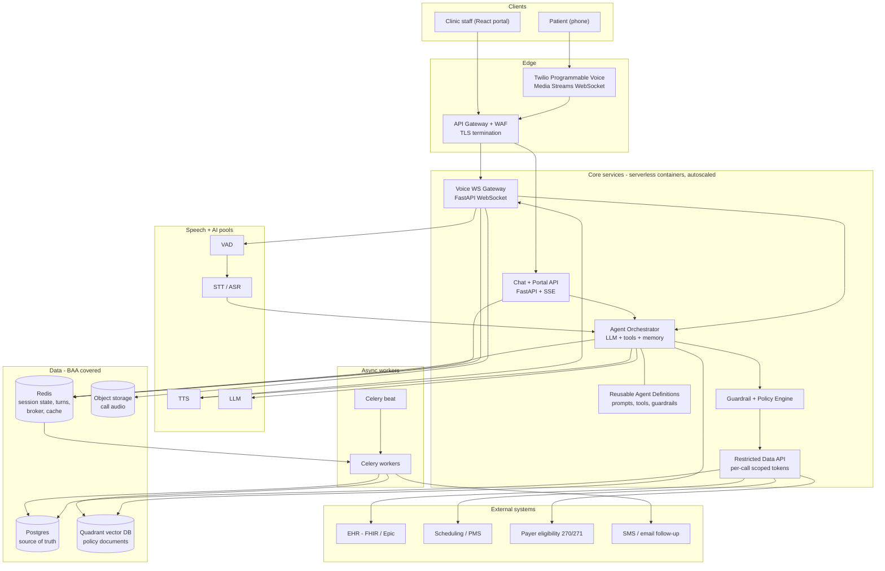
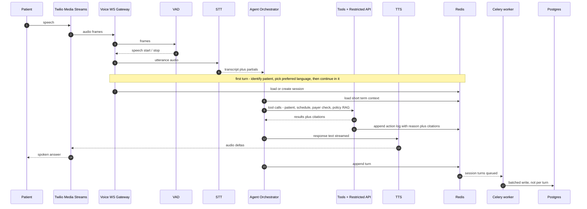
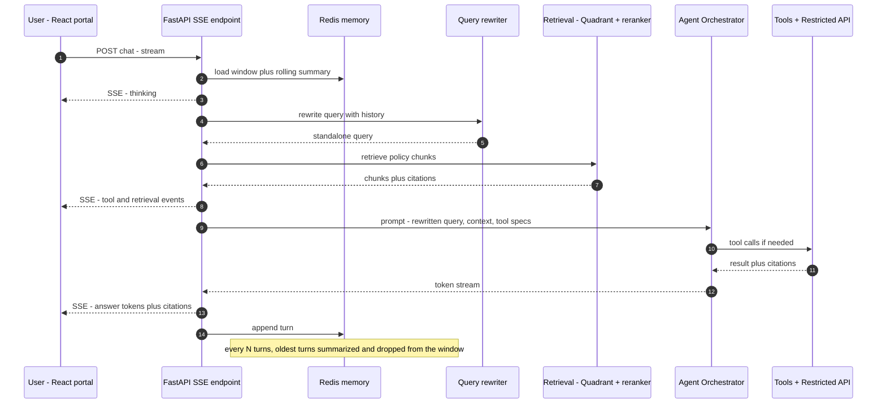
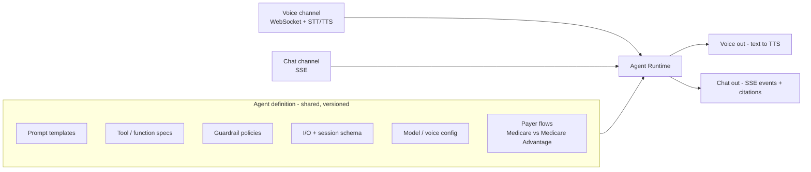
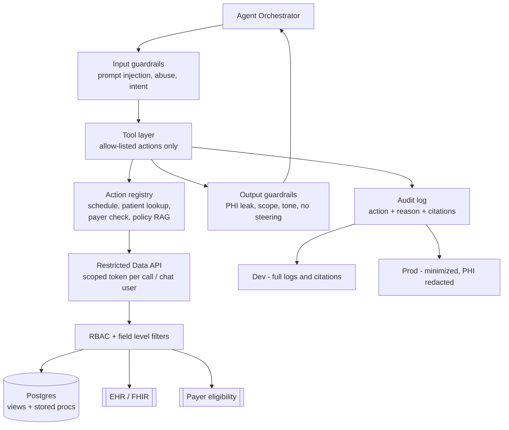
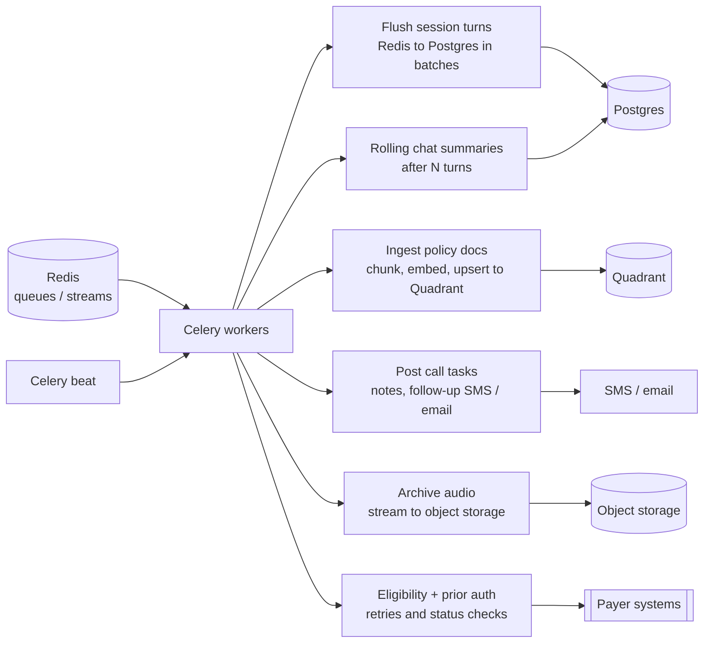

# Solution Architecture

Serverless container based, BAA-signed end to end, shared agent definitions across voice and chat,
Redis for session state, Postgres as source of truth, Quadrant for policy RAG, object storage for audio.

Diagrams are Mermaid - they render on GitHub and most Markdown viewers (VS Code preview, Obsidian, etc.).

---

## 1. System context (container view)

Notes:

- Gateways are stateless; all conversation state lives in Redis, so any container can serve any turn.
- Websockets are long lived, so the voice pool needs a warm minimum and graceful drain on scale-in.
- The orchestrator never touches Postgres directly - only the Restricted Data API does (see section 5).

---

## 2. Voice call pipeline

Low latency approach:

- VAD detects speech stop, the utterance is sent to STT while the LLM prompt and tool plan are prepared in parallel.
- TTS consumes the LLM stream sentence by sentence, so the caller hears the first sentence before generation finishes.
- Barge-in: if VAD fires while TTS is playing, playback is cut and the new utterance wins.
- All N turns are kept in Redis for the session; Postgres is written in batches by Celery to avoid per turn DB hits.

---

## 3. Chat pipeline (SSE)

Notes:

- SSE carries `thinking`, `tool_call`, `retrieval` and `token` events so the user sees progress before the final answer.
- Only recent turns are sent to the LLM; older turns become a rolling summary.
- RAG answers always carry citations; full policy files are available to the reader view, not dumped into the prompt.

---

## 4. Reusable agent layer - shared by voice and chat

- Same prompts, tools and guardrails serve both channels - only the transport and the input/output codec differ.
- New agents are added as definitions, not new services.
- Payer specific behaviour (Original Medicare vs Medicare Advantage) is a flow config, not branching code.

---

## 5. Data access + guardrails

- The agent has no direct DB or API credentials; every action goes through the registry and a token scoped to the current call or chat user.
- Dev keeps full action logs with reasoning and citations for debugging; prod keeps a minimized, redacted version.
- Output guardrails block PHI leakage and CMS-prohibited Medicare Advantage steering.

---

## 6. Async jobs - Celery

---

## 7. Data + compliance

| Store | Holds | Notes |
| --- | --- | --- |
| Redis | session state, turns, broker, cache, summaries | TTL per session, AOF on, not the system of record |
| Postgres | patients, appointments, actions, batch written transcripts | source of truth, encrypted at rest, row level access |
| Quadrant | embedded policy documents | separate collection per tenant / clinic, no PHI in the index unless required |
| Object storage | call audio, exports | BAA signed, retention policy, lifecycle expiry |

- BAA signed with every subprocessor: telecom, STT/TTS, LLM, vector DB, object storage, Postgres hosting.
- Two party consent: recording notice played before capture, consent flag stored per call.
- No direct DB access for agents, all access via the restricted API with per-call scoped tokens.
- Audit logging split: full in dev, minimized and redacted in prod.

---

## 8. Scaling + deployment

- Serverless containers per service, autoscale on CPU plus queue depth plus active websocket count.
- Voice pool keeps a warm minimum so calls never wait on a cold start; scale-in drains connections first.
- Sizing from the open questions: ~2,800 calls/day overall lands in the 3,000-3,500 peak target; if it is per clinic the target is ~39,200/day (2,800 x 14) and the speech and websocket pools scale accordingly.
- Annual Enrollment Oct 15 - Dec 7 is the peak window; payer rules and capacity must be sized for it.
- Celery workers scale independently of the gateways so ingestion and transcription never compete with live calls.

---

## 9. Open points / risks

- Batch writes: a crash before flush can lose the last turns - mitigate with AOF plus a quick flush on session end and idempotent upserts in Postgres.
- Websocket affinity: long lived connections need sticky routing or Redis backed handoff; verify drain behaviour under scale-in.
- Quadrant vendor BAA and whether policy documents may contain PHI - scope collections and access accordingly.
- Audio retention and consent rules vary by state; make retention configurable per clinic.
- Latency budget: set explicit p50 / p95 targets for VAD, STT, LLM first token and TTS first byte, and test with the 65+ caller population.
- Clinical safety: RAG answers must cite, low confidence must escalate to staff, and Medicare Advantage scripts need a compliance review.
